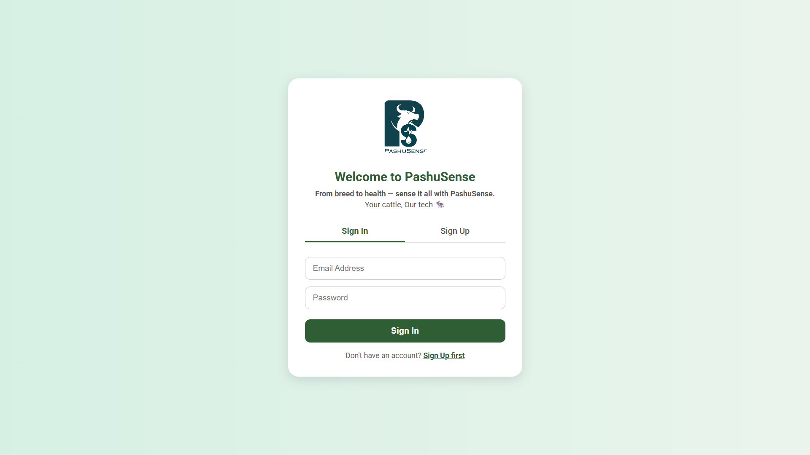
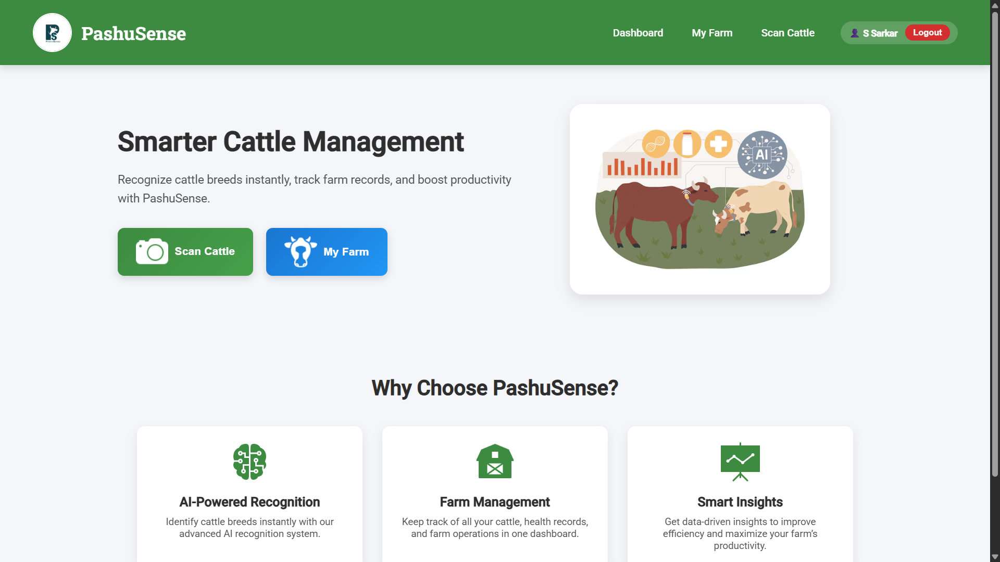
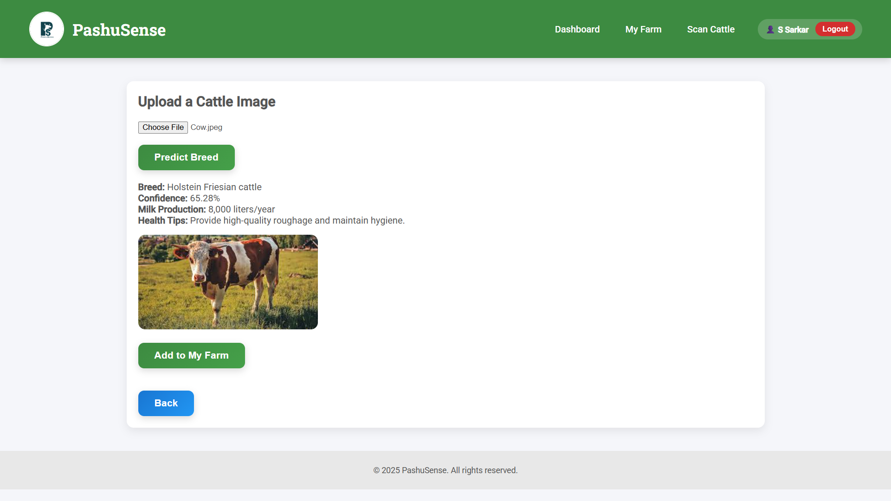
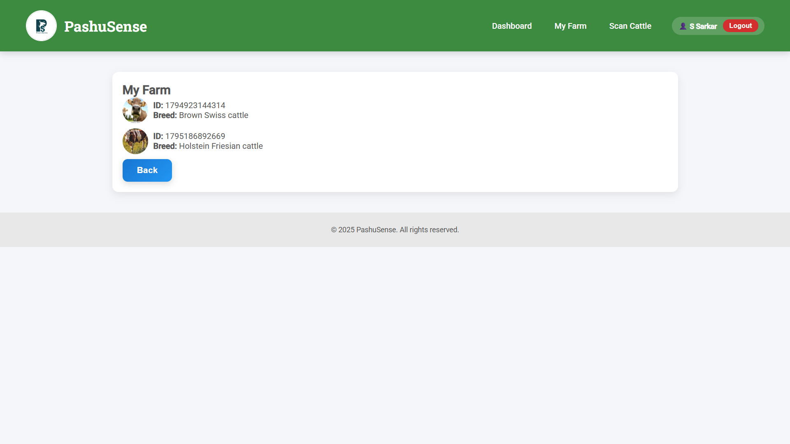

<div align="center">


# 🐄 PashuSense

### AI-Powered Cattle Breed Recognition & Farm Management Web App built with TensorFlow Lite, MobileNetV2, Flask & Docker

[](https://pashusense.onrender.com/)
[](https://www.python.org/)
[](https://www.tensorflow.org/lite)
[](https://flask.palletsprojects.com/)
[](https://www.docker.com/)
[](https://gunicorn.org/)

<br/>

**[🌐 Experience the Live Application](https://pashusense.onrender.com/)**

*From breed to health — sense it all with PashuSense. Your cattle, our tech.*

</div>

---

## 🌐 Live Demo

The application is deployed on **Render** and accessible at **[pashusense.onrender.com](https://pashusense.onrender.com/)**.

| Page | URL | Notes |
|---|---|---|
| **🔐 Sign In / Sign Up** | [Open](https://pashusense.onrender.com/) | Create an account first, then sign in |
| **🏠 Dashboard** | [Open](https://pashusense.onrender.com/dashboard) | Requires an active session |
| **❤️ Health Check** | [Open](https://pashusense.onrender.com/healthz) | JSON status + active inference engine |

> ⏱ Render's free tier sleeps after inactivity — the first request may take ~30–60 seconds to wake the server.

---

## 📖 Overview

**PashuSense** (*Pashu* = cattle in Hindi/Sanskrit) helps farmers and dairy enthusiasts identify cattle breeds from a single photo. Upload an image and the app returns the **breed, model confidence, expected milk production and health-care tips** in about **30 ms**. Identified animals can be saved to a personal **My Farm** record.

The model is a custom-trained **MobileNetV2** classifier, exported to **TensorFlow Lite** so that it runs comfortably on a free-tier, single-core CPU container with ~20 MB of RAM for inference.

---

## 📸 Screenshots

### 🔐 Sign In / Sign Up



### 🏠 Dashboard



### 📷 Scan Cattle — Breed Prediction



### 🏡 My Farm — Saved Cattle



---:|:---:|
|  |  |
| **Scan Cattle — breed prediction** | **My Farm — saved cattle** |
|  |  |

---

## ✨ Features

* **🔍 Instant Breed Recognition:** Upload a cattle photo and get the predicted breed with a confidence score.
* **🥛 Milk Production Estimates:** Typical annual yield for the identified breed.
* **💚 Health Tips:** Breed-specific feeding and care guidance.
* **🛡 Non-Cattle Rejection:** Confidence and top-2 margin gating rejects dogs, people, objects and blurry/unclear photos.
* **🏡 My Farm:** Save identified cattle (photo, ID, breed) to a per-user farm record.
* **🔐 Authentication:** Sign Up / Sign In / Logout flow with strict sign-in — an account must be registered before logging in. Farm records are kept per user.
* **⚡ Lightweight Inference:** TFLite engine, single-threaded sync Gunicorn worker — no thread deadlocks or OOM freezes on free hosting.
* **🧯 Graceful Errors:** Unsupported or corrupt image files return a friendly message instead of a server error.

---

## 🧠 How It Works

```
Upload image
     │
     ▼
Resize to 224×224 → normalize to [0, 1]
     │
     ▼
Custom MobileNetV2 (TFLite, 5 breeds)  ──►  softmax probabilities
     │
     ├─ Confidence < 60%  or  top-1 vs top-2 margin < 0.20
     │        └─► ❌ "This does not appear to be a clear cattle image"
     │
     └─ ✅ Breed + Confidence + Milk Production + Health Tips
```

The engine prefers `cattle_breed_model.tflite` and automatically falls back to rebuilding the Keras model from `cattle_breed_model.h5` if the TFLite file is missing.

---

## 🐮 Breeds Supported

| Breed | Milk Production | Health Tip |
|---|---|---|
| Ayrshire cattle | 6,000 L/year | Well-ventilated barn, balanced feed |
| Brown Swiss cattle | 7,500 L/year | Regular exercise, check for mastitis |
| Holstein Friesian cattle | 8,000 L/year | High-quality roughage, hygiene |
| Jersey cattle | 5,500 L/year | Monitor calcium intake |
| Red Dane cattle | 6,500 L/year | Clean water, vaccination |

---

## 🛠 Tech Stack & Architecture

| Layer | Technology | Description |
|---|---|---|
| **Frontend** | HTML5, CSS3, Vanilla JavaScript | Responsive pages served by Flask templates |
| **Backend** | Flask 3 + Flask-CORS | REST API (`/predict`) and page routing |
| **ML Model** | MobileNetV2 (transfer learning, 5 classes) | Trained in Google Colab, exported to `.h5` and `.tflite` |
| **Inference** | TensorFlow Lite Interpreter | ~30 ms per prediction, single-thread pinned |
| **Imaging** | Pillow, NumPy | In-memory resize and normalization |
| **Auth & Farm Data** | Browser `localStorage` | Database-free per-user accounts and farm records |
| **Server** | Gunicorn (1 sync worker) | Avoids thread storms on shared-CPU containers |
| **Containerization** | Docker | `python:3.12-slim` image |
| **Deployment** | Render | Configured via `render.yaml` |

> ℹ️ Accounts and farm records live in the user's browser (`localStorage`) — there is no server-side database, so data is per-device and not intended for production-grade security.

---

## 🔌 API Reference

### `GET /healthz`
Returns server and engine status.
```json
{ "status": "healthy", "engine": "tflite" }
```

### `POST /predict`
Multipart form upload with a `file` field (JPG / JPEG / PNG / WebP).

```bash
curl -X POST -F "file=@Cow.jpeg" https://pashusense.onrender.com/predict
```

**Success**
```json
{
  "breed": "Holstein Friesian cattle",
  "confidence": 65.28,
  "milk_production": "8,000 liters/year",
  "health_tips": "Provide high-quality roughage and maintain hygiene."
}
```

**Rejected / unreadable image**
```json
{ "error": "This does not appear to be a clear cattle image (confidence 41.2% is low). Please upload a clear, close-up photo of a cow." }
```

---

## 📂 Project Directory Structure

```
PashuSense
│
├── app.py                          # Flask server + TFLite inference pipeline
├── breed_data.py                   # Breed metadata (milk production, health tips)
├── labels.txt                      # 5 breed class names
├── cattle_breed_model.tflite       # Lightweight production model (~2.5 MB)
├── cattle_breed_model.h5           # Keras weights (fallback engine)
├── convert_model.py                # H5 → TFLite conversion script
├── Cattles__Recognization.ipynb    # Google Colab training / demo notebook
│
├── login.html                      # Sign In / Sign Up page
├── index.html                      # Dashboard, Scan Cattle & My Farm UI
├── plogo.png · vector.jpg          # Branding assets
│
├── requirements.txt                # Pinned Python dependencies
├── Dockerfile                      # Container build
├── render.yaml                     # Render deployment blueprint
├── Procfile · setup.sh             # Alternative process / setup configs
├── .github/workflows/deploy.yml    # Optional SSH auto-deploy workflow
│
└── screenshots/                    # UI captures used in this README
```

> The `Cattle Breeds/` training dataset and `Cattles/` sample folder are excluded from the repo (see `.gitignore`).

---

## 🚀 Local Setup & Installation

> Requires **Python 3.9–3.12** — TensorFlow does not support Python 3.13 yet.

### Option 1: Run with Python

```bash
# 1. Clone the repository
git clone https://github.com/Souvik686/PashuSense.git
cd PashuSense

# 2. (Recommended) create a virtual environment
python -m venv venv
source venv/bin/activate        # Windows: venv\Scripts\activate

# 3. Install dependencies and start the server
pip install -r requirements.txt
python app.py
```

Open **http://localhost:8000**, sign up, and start scanning.

### Option 2: Run with Gunicorn (production-style)

```bash
gunicorn --bind 0.0.0.0:8000 app:app --workers 1 --worker-class sync --timeout 120
```

### Option 3: Run with Docker

```bash
docker build -t pashusense .
docker run -p 7860:7860 pashusense
# Open: http://localhost:7860
```

### Option 4: Google Colab

1. Open `Cattles__Recognization.ipynb` in [Google Colab](https://colab.research.google.com).
2. Upload `cattle_breed_model.h5`, `breed_data.py`, `labels.txt` and `index.html` when prompted.
3. Add your free [ngrok](https://ngrok.com/signup) auth token in the last cell, run all cells and open the generated URL.

---

## ☁️ Deployment (Render)

The repo ships with a [`render.yaml`](render.yaml) blueprint:

1. Push the repo to GitHub.
2. In Render, choose **New → Blueprint** and select the repository.
3. Render installs `requirements.txt` and starts Gunicorn with a single sync worker (`PYTHON_VERSION=3.11.9`).

---

## 🔮 Future Improvements

* Server-side database with hashed-password authentication
* More Indian and exotic breeds (Gir, Sahiwal, Murrah, Tharparkar…)
* Disease and health-condition detection from images
* Export farm records as CSV / PDF
* Multi-language support (Hindi, Bengali, …)

---

## 👨‍💻 Author

**Souvik Sarkar** — [GitHub @Souvik686](https://github.com/Souvik686)

<div align="center">

⭐ If you found this project useful, please consider giving it a star!

© 2025 PashuSense. All rights reserved.

</div>
